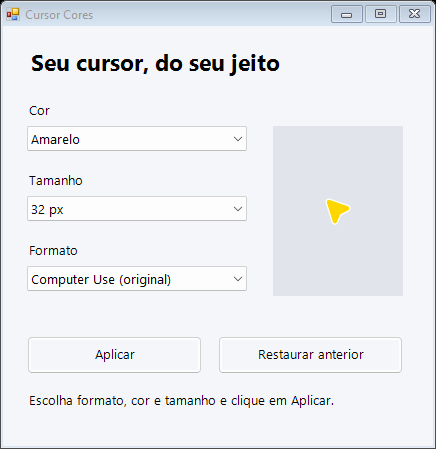
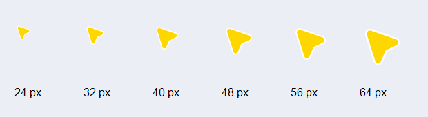

# Cursor Cores para Windows

Aplicativo portátil para escolher **formato, cor e tamanho do cursor**, com prévia e restauração da configuração anterior.

## Baixar o programa atualizado

Abra a [versão mais recente](https://github.com/poajefersonld-1983/cursor-cores/releases/latest) e baixe **Cursor.Cores.exe** ou o pacote ZIP completo. Dentro do ZIP, o arquivo se chama `Cursor Cores.exe`. O executável contém os cursores e o monitor; não precisa da pasta `Base` para funcionar. Requer .NET Framework 4.x no Windows.

Para atualizar a versão que você já usa:

1. Feche a janela antiga e encerre o monitor pelo ícone Cursor Cores na bandeja.
2. Substitua seu `Cursor Cores.exe` pelo novo arquivo baixado.
3. Abra o novo programa, escolha **32 ou 40 px** e clique em **Aplicar**.

Também há um instalador opcional no pacote: `Instalar-Atualizacao.ps1`. Ele instala para o usuário atual, atualiza o atalho do menu Iniciar e preserva as preferências e backups. Não precisa de administrador. Antes de usá-lo, extraia o ZIP completo, mantendo o script ao lado do executável.

## O ajuste dos tamanhos

A versão anterior oferecia 24, 48 e 64 px: o primeiro salto dobrava o tamanho. Agora há **24, 32, 40, 48, 56 e 64 px**, em passos de 8 px.

Configurações novas começam em 32 px. Preferências antigas mantêm o valor escolhido, por isso quem já usava 24 px deve selecionar 32 ou 40 px para aumentar o cursor.





As imagens são geradas pelo próprio programa durante os testes nativos Windows. A aparência das bordas da janela pode variar conforme o tema do sistema.

## Recursos

- Treze formatos: Clássica, Moderna, Compacta, Alongada, Larga, Contorno, Chevron, Triângulo, Diamante, Mira, Círculo, Gota e Computer Use.
- Dez cores predefinidas e escolha de cor personalizada.
- Prévia pelo mesmo renderizador usado para gerar o ponteiro aplicado.
- Persistência da cor, formato e tamanho escolhidos.
- Monitor na bandeja para reaplicar o tamanho quando o Windows recarregar os cursores.
- Monitor com instância única por usuário e inicialização no próximo login após aplicar.
- Respeito a cursores temporariamente ocultos: o monitor não chama ShowCursor nem tenta revelá-los.
- **Restaurar anterior** recupera a configuração salva antes da primeira aplicação e desativa o monitor.

Dados e temas gerados ficam em `%LOCALAPPDATA%\CursorCores`. Os formatos dos arquivos de preferências e backups da versão anterior foram mantidos. O monitor desta versão é uma implementação nova, incluída no repositório completo; o módulo original não pôde ser recuperado do Drive.

A função de agitar para ampliar não faz parte deste aplicativo. Aplicativos e páginas que desenham um cursor próprio podem manter o próprio desenho.

## Compilar e testar

A pasta `Base` é necessária apenas para compilar:

```powershell
.\compilar.ps1
.\tests\Testar.ps1
```

O script usa o compilador .NET Framework do Windows e incorpora os cursores ao executável. Os testes verificam a interface, o padrão de 32 px, preferências antigas, os 13 desenhos em três cores, quadros animados e dimensões efetivamente carregadas pelo Windows. Também verificam o leitor de preferências do monitor e executam as verificações do `.exe` completo em uma pasta temporária, sem arquivos externos.

O teste automatizado não altera o cursor ativo. Os resultados ficam em [verificacao](verificacao) e no [GitHub Actions](https://github.com/poajefersonld-1983/cursor-cores/actions).

Comandos de diagnóstico, sem aplicar cursores:

```powershell
& '.\Cursor Cores.exe' --verify
& '.\Cursor Cores.exe' --test-persistence
```

`--verify` valida 102 arquivos usando o carregador nativo. `--test-persistence` verifica os seis tamanhos no leitor do monitor. `--stop-guard` encerra o monitor e desativa sua inicialização automática.

O script `Atualizar.ps1` continua disponível para aplicar apenas o ajuste de tamanhos a uma pasta de fontes anterior, usando o monitor e o compilador que já existam nela. Para instalar a versão completa publicada aqui, prefira o novo executável.

## Base visual

Bibata Modern Amber v2.0.6, de [ful1e5](https://github.com/ful1e5/Bibata_Cursor), com licença em [LICENSE-Bibata](LICENSE-Bibata). Os desenhos personalizados foram preservados do projeto Cursor Cores do usuário.
